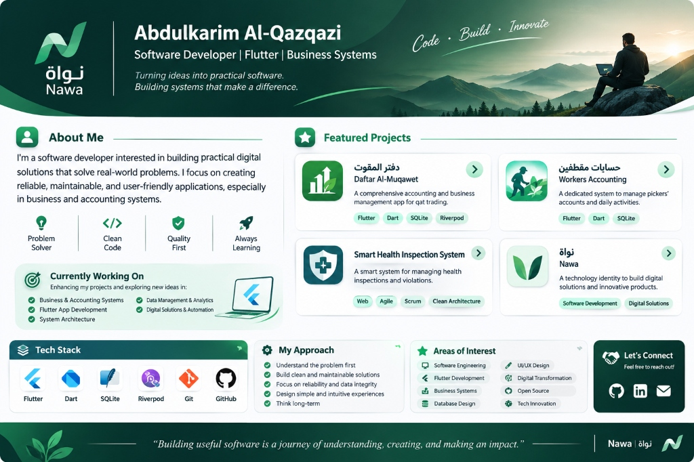

<p align="center">
  
</p>

<p align="center">
  <a href="https://git.io/typing-svg">
    
  </a>
</p>

<p align="center">
  <em>"Turning real-world challenges into practical digital solutions through clean engineering and intelligent systems."</em>
</p>

<p align="center">
  <a href="https://github.com/alqazqaziabdulkarim-lang">
    
  </a>
  
  
  
</p>

---

### 🌟 Core Engineering Values

<table width="100%" align="center">
  <tr>
    <td align="center" width="25%">
      <h3>💡 Problem Solver</h3>
      <p>Deep dive into business domain before writing a single line of code.</p>
    </td>
    <td align="center" width="25%">
      <h3>💻 Clean Code</h3>
      <p>Clean Architecture, SOLID principles & high maintainability.</p>
    </td>
    <td align="center" width="25%">
      <h3>🛡️ Quality First</h3>
      <p>Robust data integrity, comprehensive workflows & reliability.</p>
    </td>
    <td align="center" width="25%">
      <h3>🚀 Always Learning</h3>
      <p>Continuous evolution across modern frameworks, cloud & AI.</p>
    </td>
  </tr>
</table>

---

## 👨‍💻 About Me

I am a **Software Developer & System Architect** passionate about designing and building end-to-end digital systems that transform business operations. 

My work bridges **cross-platform mobile applications**, **robust backend services**, and **AI-powered integrations**. Rather than just writing functional code, I dedicate myself to domain modeling, clean software architecture, bulletproof data consistency, and delivering intuitive user experiences.

```yaml
Name: Abdulkarim Al-Qazqazi (عبدالكريم القزقزي)
Identity: Nawa (نواة) - "كل منتج يبدأ بفكرة"
Primary Stack: Flutter (Dart) | C# (.NET / ASP.NET Core) | Angular | SQLite / SQL Server
Specialization: ERPs, Business Accounting, Cross-Platform Apps, Clean Architecture
Location: Yemen 🇾🇪
Email: abdulkarimalqazqazi@gmail.com
LinkedIn: linkedin.com/in/abdulkarim-alqazqazi-5a56763b6
Phone: +967 782 866 088
Telegram: @Eng_abdulkarim_IT
Open For: Impactful Projects & Technical Collaboration
```

### 🎯 Currently Focused On:
- 📱 Developing feature-rich **Flutter & Riverpod** applications with offline-first synchronization.
- ⚡ Designing scalable **ASP.NET Core (.NET 9/10)** backends powered by **Clean Architecture** & **SignalR**.
- 📊 Architecting specialized **Accounting & ERP Systems** tailored for localized trade workflows.
- 🤖 Integrating **AI & Computer Vision** assistants into practical industrial & automotive workflows.

---

## 🚀 Featured Projects

<table>
  <!-- Project 1: Sayyar Smart -->
  <tr>
    <td width="50%" valign="top">
      <h3>🚗 Sayyar Smart System | منظومة سيّار الذكيّة</h3>
      <p><strong>AI-Powered Automotive E-Commerce & Customer Assistance Ecosystem</strong></p>
      <p>An integrated digital ecosystem transforming automotive spare-parts commerce. Connects merchants, clients, and technical advisors via web, mobile, and Telegram bot.</p>
      <ul>
        <li><b>Web Platform:</b> Comprehensive management for catalog, stock, and orders.</li>
        <li><b>Mobile App (Flutter):</b> High-performance parts browsing and tracking.</li>
        <li><b>AI Assistant:</b> Interactive vehicle diagnosis by make/model with actionable advice.</li>
        <li><b>Real-Time Sync:</b> Instant notifications and status updates via SignalR.</li>
      </ul>
      <p>
        
        
        
        
        
        
      </p>
    </td>
    <!-- Project 2: Daftar Al-Muqawet -->
    <td width="50%" valign="top">
      <h3>🌿 Daftar Al-Muqawet | دفتر المقوت</h3>
      <p><strong>Specialized Agricultural Trading & Accounting ERP System</strong></p>
      <p>A mission-critical Flutter accounting system organizing multi-party agricultural commerce, daily sessions, and debt settlements.</p>
      <ul>
        <li><b>Financial Accounting:</b> Customer/supplier ledger, daily debts, settlements, P&L.</li>
        <li><b>Harvest Sessions:</b> Real-time batch distributions, expenses, picker wages.</li>
        <li><b>Offline First:</b> High-integrity local SQLite database with Google Drive backups.</li>
        <li><b>Reporting:</b> Instant localized PDF invoice & report generation.</li>
      </ul>
      <p>
        
        
        
        
        
      </p>
    </td>
  </tr>

  <!-- Project 3: Workers Accounting -->
  <tr>
    <td width="50%" valign="top">
      <h3>👷 Workers Accounting System | حسابات مقطفين</h3>
      <p><strong>Workforce Accounting & Daily Field Operations Management</strong></p>
      <p>Mobile-first operational system designed to manage agricultural labor teams, piecework compensation, and operational expense distributions.</p>
      <ul>
        <li><b>Yield Tracking:</b> Real-time quantity recording per worker.</li>
        <li><b>Automated Payroll:</b> Dynamic wage calculation based on agreed rates.</li>
        <li><b>Shared Costs:</b> Shared meal expenses, advances, deductions & settlements.</li>
      </ul>
      <p>
        
        
        
        
      </p>
    </td>
    <!-- Project 4: Smart Health Inspection -->
    <td width="50%" valign="top">
      <h3>🏥 Smart Health Inspection System</h3>
      <p><strong>Regulatory Health Inspection Platform (Graduation Project)</strong></p>
      <p>Enterprise platform built by a 7-developer team to digitize municipality inspections of food establishments using mobile tools and AI.</p>
      <ul>
        <li><b>Role:</b> Team Manager & Product Owner (Agile / Scrum, Jira).</li>
        <li><b>AI Detection:</b> Camera-assisted recognition of health violations.</li>
        <li><b>Architecture:</b> Micro-modular backend with Angular admin portal.</li>
      </ul>
      <p>
        
        
        
        
        
      </p>
    </td>
  </tr>
</table>

<details>
  <summary><b>🧩 About "Nawa | نواة" — Product Philosophy & Brand Identity</b> (Click to expand)</summary>
  <br/>
  <blockquote>
    <em>"كل منتج يبدأ بفكرة — Every product starts with a core idea."</em>
  </blockquote>
  <p>
    <b>Nawa (نواة)</b> represents my personal engineering identity and vision. It reflects a philosophy grounded in:
  </p>
  <ul>
    <li><b>Problem-Centric Discovery:</b> Understanding the real business friction before picking a technical stack.</li>
    <li><b>Architectural Rigor:</b> Decoupling business logic from frameworks to ensure software outlives technology trends.</li>
    <li><b>Data Precision:</b> Zero tolerance for financial discrepancies and state desynchronization.</li>
    <li><b>Human Experience:</b> Turning intricate operational rules into simple, friendly user interfaces.</li>
  </ul>
</details>

---

## 🛠️ Tech Stack & Tooling

<div align="center">

| Domain | Technologies & Frameworks |
|---|---|
| **Mobile Development** |    |
| **Backend & APIs** |     |
| **Web Frontend** |     |
| **Databases & Storage** |    |
| **Architecture & Design** |    |
| **Management & DevOps** |      |

</div>

---

## 📊 GitHub Analytics

<p align="center">
  
  
</p>

<p align="center">
  
</p>

<p align="center">
  
</p>

---

## 🧠 Engineering Philosophy & Methodology

<table width="100%">
  <thead>
    <tr>
      <th width="30%">Principle</th>
      <th width="70%">Execution in Practice</th>
    </tr>
  </thead>
  <tbody>
    <tr>
      <td><b>🎯 Problem First</b></td>
      <td>Thoroughly deconstruct user requirements and operational friction before making framework decisions.</td>
    </tr>
    <tr>
      <td><b>🏛️ Clean Architecture</b></td>
      <td>Enforce strict separation between Domain, Application, Infrastructure, and UI layers.</td>
    </tr>
    <tr>
      <td><b>🔒 Data Integrity</b></td>
      <td>Treat ACID properties, schema validation, and auditability as non-negotiable fundamentals.</td>
    </tr>
    <tr>
      <td><b>🔄 Reusability</b></td>
      <td>Architect modular design systems, reusable packages, and centralized API clients.</td>
    </tr>
    <tr>
      <td><b>⚡ Intuitive UX</b></td>
      <td>Hide complex accounting or inventory calculations behind responsive, effortless user interactions.</td>
    </tr>
    <tr>
      <td><b>📈 Continuous Evolution</b></td>
      <td>Practice code reviews, automated linting, iterative refactoring, and modern tech adoption.</td>
    </tr>
  </tbody>
</table>

---

## 🤝 Let's Connect

<p align="center">
  <a href="https://linkedin.com/in/abdulkarim-alqazqazi-5a56763b6">
    
  </a>
  <a href="mailto:abdulkarimalqazqazi@gmail.com">
    
  </a>
  <a href="https://wa.me/967782866088">
    
  </a>
  <a href="https://t.me/Eng_abdulkarim_IT">
    
  </a>
  <a href="https://github.com/alqazqaziabdulkarim-lang">
    
  </a>
</p>

---

<p align="center">
  <em>“Building useful software is a journey of understanding, creating, and making an impact.”</em>
</p>

<p align="center">
  <b>Nawa | نواة</b> &nbsp;•&nbsp; <b>كل منتج يبدأ بفكرة</b>
</p>

<p align="center">
  
</p>
